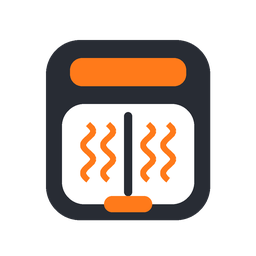
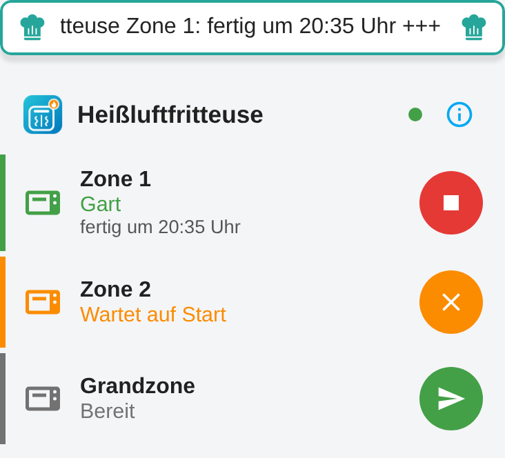
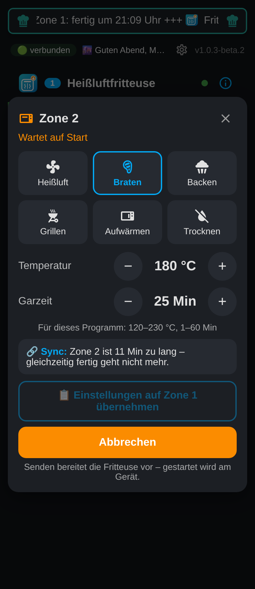
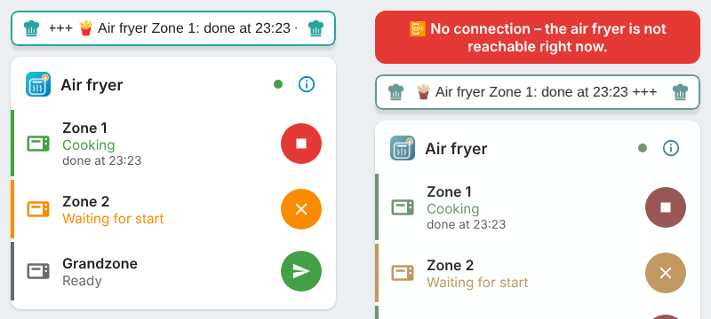

# 🍟 Airfryer Control for Home Assistant

🇩🇪 **Deutsch?** → [README auf Deutsch](README.md)

**Your Cosori air fryer on your dashboard.** Time remaining, “done at”, temperature and program for each zone. Plus a notification when the food is ready (“🍟 Fries are done!”), a stop button, two ready-made cards and a small phone app. Built for models the official VeSync integration does **not** know, first of all the **Dual Blaze TwinFry 10 L** (CAF-TF101S / CAF-TF102S).

One click opens it right in your Home Assistant: [](https://my.home-assistant.io/redirect/hacs_repository/?owner=misterm2310&repository=airfryer-control&category=integration) [](https://my.home-assistant.io/redirect/config_flow_start/?domain=airfryer_control)

<p align="center"> </p>

<details><summary>📱 See the phone app</summary>

<p align="center"></p>

</details>

> 🧪 **Unofficial & partly beta:** Cosori does not publish how its fryers talk. Some things are **not yet checked on every real fryer** – see [what doesn't work (yet)](#-honestly-what-doesnt-work-yet).

---

## ✨ What can it do?

- 🔥 **Status, time remaining and “done at”** – overall and per zone (Grandzone too).
- 📤 **Send like the app:** program, temperature and time go to the fryer, you start on the device.
- 🔔 **“Done” event** for phone notifications, announcements or pausing the TV.
- 🃏 **Two ready-made cards** (zone card + ticker) and a 📱 **phone app** – nothing extra to install.
- 🟰 **Match & Sync** so both zones finish at the same time.
- 🛡️ **Privacy:** your password is not stored, only Home Assistant talks to VeSync.

<details><summary>📋 All features in detail</summary>

| Feature | How |
|---|---|
| 🔥 **Status** | Off, Ready, Waiting for start, Preheating, Cooking, Paused, Drawer open, Done, Keeping warm, Offline. |
| ⏱️ **Time remaining & “done at”** | In minutes and as a time – overall and per zone. |
| 🧩 **Zones** | On the TwinFry, separate entities for zone 1, zone 2 and the **Grandzone** (the whole drawer without divider, the fryer calls it zone 3). A TwinFry always keeps its zones – even if it is silent for a moment while Home Assistant starts. **Grandzone ↔ zone 1/2 switches automatically:** if the other side is only prepared (“Waiting for start”), it is reset first. If it is cooking, nothing is stopped – you get a clear message instead (“The whole basket is cooking right now – please stop it first”). |
| 🌡️ **Limits** | Temperature follows the program: Air Fry 120–205 °C, Roast 120–205 °C, Bake 80–205 °C, Grill 205–240 °C, Reheat 40–205 °C. If a value is not accepted, the integration tells you in plain words. |
| 🌡️ **Temperature & program** | Target temperature, measured temperature (if reported) and program (AirFry, Roast …). |
| 🔔 **“Done” event** | `airfryer_control_fertig` – for phone notifications, announcements or pausing the TV. |
| 📤 **Send (like the app)** | Set program, temperature and time per zone, then turn the switch **“Zone n send / stop”** on – like “Send” in the VeSync app. The fryer wakes up and waits for you to press Start on the device. (Cosori blocks remote start in the EU.) |
| ⏹️ **Stop cooking** | Button for the whole fryer – and the same switch per zone: off = stop that zone. |
| 🎛️ **Change temperature & time** | Number fields per zone. If the zone is already cooking, new values go straight to the fryer. |
| 🐢🐇 **Smart polling** | Idle: every 60 seconds (adjustable). Cooking: every 15 seconds. If it misses one answer, the last values stay and it asks again after 5 seconds – “Offline” only shows once it has been silent for more than 90 seconds. |
| 🛡️ **Privacy** | Your password is not stored, identifiers are redacted everywhere. Details below. |

</details>

---

## 📦 Installation

1. Open **HACS** (from Home Assistant 2026.11: **Settings › Marketplace**) → top right **⋮ → Custom repositories**.
2. Add `https://github.com/misterm2310/airfryer-control`, type **Integration**.
3. Search **Airfryer Control** → ⋮ → **Redownload** → pick the newest → **Download**.
4. **Restart Home Assistant.**
5. **Settings → Devices & services → Add integration → Airfryer Control.**
6. Sign in with **the same account as in the VeSync app**, choose region **EU** or **US** – done. 🎉

<details><summary>Without HACS (manual)</summary>

Copy `custom_components/airfryer_control` to `/config/custom_components/airfryer_control` and restart Home Assistant.
</details>

> 💡 **Tip:** The fryer has to be set up in the VeSync app first. You can keep using the app – both work at the same time.

---

## 👀 What you get

<details><summary>All sensors, switches and buttons – <i>expand</i></summary>

One device per air fryer. Entity IDs depend on the name in the app (here “Fritteuse”) and your Home Assistant language:

| Entity | Contents |
|---|---|
| `sensor.fritteuse_status` | Overall status (attribute `rohwert` = what the fryer actually reported) |
| `sensor.fritteuse_time_remaining` | Minutes until done (overall) |
| `sensor.fritteuse_done_at` | Time when everything is done |
| `sensor.fritteuse_zone_1_…` / `zone_2_…` / `zone_3_…` (Grandzone) | Status, time remaining, done at, program (only while cooking) |
| `select.fritteuse_zone_1_program` / `zone_2_…` / `zone_3_…` | Program used by “send”: Air Fry, Roast, Bake, Grill, Reheat, Dry. Changing it resets temperature and time to the fryer's suggested values. |
| `number.fritteuse_zone_1_set_temperature` / `…_set_cooking_time` | Temperature (35–240 °C) / minutes – sent along when you send. Time limits per program: Air Fry 1–60, Roast 1–240, Bake 1–240, Grill 1–30, Reheat 1–60, Dry 1–2880 (48 h); Dry 34–95 °C |
| `switch.fritteuse_zone_1_send_stop` / `zone_2_…` / `zone_3_…` | **On = send the values to the fryer** (it then waits for Start on the device). **Off = stop the zone.** Program, temperature and time are attributes. |
| `binary_sensor.fritteuse_cooking` | On while preheating, cooking or briefly paused |
| `button.fritteuse_stop_cooking` | Stop |
| *Diagnostic:* `binary_sensor.fritteuse_online`, `button.fritteuse_refresh_now`, `sensor.fritteuse_raw_data` | Connection, poll now, last cloud response (without identifiers) |

</details>

---

## 🃏 Ready-made cards

Shipped with the integration and registered automatically: **Add card** → search for **Airfryer Control**. 🎉

<details><summary>Zone card, ticker, Match & Sync – <i>expand</i></summary>

Nothing extra to install – the integration ships two cards and registers them as dashboard resources automatically. In your dashboard choose **Add card** and search for **Airfryer Control** (reload the page once after an update).

| Card | What it does |
|---|---|
| `custom:airfryer-control-card` | One row per zone (Zone 1, Zone 2, Grandzone) with status, “done at …” and a round **send / cancel / stop** button. Tap a row for a dialog with program, temperature and time (per-program limits respected). The (i) shows credits, donation link and privacy. |
| `custom:airfryer-control-ticker` | The **ticker**: “Air fryer Zone 1: done at 19:42 +++ Zone 2: waiting for start”. Frame **red and pulsing** when a zone is done, otherwise teal. Hides itself when idle. Optionally includes extra timers (e.g. `sensor.einkaufsliste_kochtimer`). |

```yaml
type: custom:airfryer-control-card
title: Air fryer
maskottchen: true   # 🍟 little air fryer with a face top left (default: off)
statuszeile: true   # 🟢 bar above the card: connected, greeting, ⚙️, version (default: on)
anleitung: true     # 📖 “Guide” button below the card (default: on)
```
```yaml
type: custom:airfryer-control-ticker
hide_when_idle: true
extra_entities:
  - sensor.einkaufsliste_kochtimer
```

The phone page and the sidebar (option “📌 Show in sidebar”, off by default) show the same cards. For the sidebar you switch the mascot on in the same options (“🍟 Show mascot in the sidebar”).

Both cards have an editor, follow light/dark and run smoothly on a Fire TV. Zones are detected automatically. The cards only talk to your Home Assistant.

<p align="center"> </p>

**📋 Match and 🔗 Sync (in the card):** In a zone's dialog, **“Copy settings to Zone 2”** copies program, temperature and time to the other zone (Match). Above it, a hint tells you **when to start the other zone so both finish together** (Sync), e.g. “start Zone 2 in 4 min”. Honestly: there are no known Cosori cloud commands for this, so it is **my own solution**: the card only calculates and copies values. You still start on the device. Neither exists for the whole drawer.

**🟰 Send Match / 🔗 Send Sync:** The zone dialog also has two buttons (and the services `match_senden` / `sync_senden`) that send Match or Sync to the fryer like the VeSync app – **prepare only** (zone shows “Waiting for start”), you start on the device. Match uses the values of the zone you are in. In Sync the shorter zone gets a wait time (state “Waiting for sync start” with remaining time). **If a zone is cooking, nothing is sent** – the fryer is never changed mid-cook. ⚠️ Honestly: the app command is rebuilt (`startMultiCook` with `syncType` 1/2). It was tested on a **Turbo Tower Pro**, **not yet on the TwinFry**.

> 🧪 The cards are still **beta** – if something is off, please report it.

</details>

---

## 📱 The phone app

<details><summary>Ticker and zone card full screen, no app store – <i>expand</i></summary>

The integration ships **its own small page**: **`/airfryer_control/app/`** behind your Home Assistant address (e.g. `https://your-name.ui.nabu.casa/airfryer_control/app/`). It shows the ticker and the zone card full screen.

1. Open the address in your phone or tablet browser (Chrome/Safari, **not** the HA app). The ready-made address to copy is also in the card under **📖 Guide → 📱 As an app on your phone**.
2. **Sign in** (with your Home Assistant account, just like the Home Assistant app). The page itself contains no data.
3. In the browser menu choose **“Add to home screen”** – done, the icon opens the air fryer directly.

> ⚠️ **Don't save the dashboard as a shortcut!** That just opens the Home Assistant start page. It's right when the address ends in **`/airfryer_control/app/`**.

The **🔅 Keep screen on** button keeps the display awake (handy for a kitchen tablet).

**Honestly:** without a connection nothing works on the fryer, because every command goes through Home Assistant and the Cosori cloud. So the app then shows **“No connection”** and **never** remembers a command to send it later (a delayed start would be dangerous). Only the program is cached so it starts fast. “Add to home screen” and fast start usually need an **https address** (e.g. Nabu Casa).

</details>

---

## 🤖 Automations

<details><summary>“Done” event, ready-made example and all actions – <i>expand</i></summary>

The event `airfryer_control_fertig` carries `geraet` (name), `modell`, `zone` (`1`, `2`, `3` or `alle` = whole fryer), `zustand` and `programm`.

```yaml
alias: Air fryer – food is ready
description: "Sends a phone notification as soon as the Cosori air fryer is completely done."
mode: single
triggers:
  - trigger: event
    event_type: airfryer_control_fertig
    event_data:
      zone: alle
conditions:
  # Maintenance switch: if it is on, stay quiet. Don't have one? Delete this condition.
  - condition: state
    entity_id: input_boolean.schalter_wartung
    state: "off"
actions:
  - action: notify.mobile_app_your_phone
    continue_on_error: true
    data:
      title: "🍟 Food is ready!"
      message: "{{ trigger.event.data.geraet }} is done. Enjoy!"
      data:
        ttl: 0
        priority: high
        sticky: true
        car_ui: true
        notification_icon: mdi:french-fries
        tag: fritteuse_fertig_01
```

| Action | What it does |
|---|---|
| `airfryer_control.senden_testen` | **For tinkerers, admins only:** sends `zone`, `temperatur`, `minuten`, `programm` to the fryer (without starting) and shows which variant it accepted. Without `variante` the safe variants are tried in turn until one works (never with start). |
| `airfryer_control.garen_beenden` | Stop. |
| `airfryer_control.programm_senden` | **For all users** (no admin rights needed, e.g. for the shopping list): sends `zone`, `temperatur`, `minuten`, `programm` to the fryer – **prepare only**, it never starts by itself. Temperature and time are limited to the program's range. Without `geraet` the only fryer is used. Response: `ok`, `ergebnis` and on failure `fehler`/`code`. Extras for other integrations below. |
| `airfryer_control.faehigkeiten` | **For all users, read only:** programs, temperature and time limits and zones of a fryer – each marked **confirmed** or only **estimated**. Plus `verbindung`, `letzte_meldung` and `revision`. |
| `airfryer_control.match_senden` | **Match:** sends program, temperature and time of one zone (`quelle`, default 1) to both zones. Prepares only – start on the device. If a zone is cooking, nothing is sent. Extras see “For other integrations”. |
| `airfryer_control.sync_senden` | **Sync:** sends both zones with their times; the shorter zone waits (state “Waiting for sync start”) so both finish together. Prepares only – start on the device. If a zone is cooking, nothing is sent. Extras see “For other integrations”. |
| `airfryer_control.befehl_senden` | **Tinkerers, admins only:** sends an app command and returns the response (without account data). |

</details>

<details><summary><b>🔌 For other integrations (e.g. Airfryer Recipes) – 🧪 beta</b></summary>

Other integrations should **not** talk to the cloud themselves. They just use the actions above. Login and device communication stay entirely with Airfryer Control.

**`programm_senden` extras (all optional – without them everything works as before):**

| Field | What it does |
|---|---|
| `variante` | Exactly this safe variant (`multi_app`, `multi_app_celsius`, `multi_app_zone0`). The starting form is never allowed here. |
| `einmal: true` | **Exactly one command.** No second variant, no automatic repeat after a new login. If the token expired you get `abgelehnt` (nothing sent) – the next attempt logs in first. |
| `streng: true` | Values outside the program limits are **rejected** (`fehler: ausserhalb_grenzen` with `grenzen`) instead of silently adjusted. |
| `bestaetigen: true` | After sending, check up to 3 times (about 6 s) whether the zone really shows the values → `bestaetigt: true/false` and `am_geraet`. |

**Response:** `ok`, `ergebnis`, `variante`, `versuche`, `gesendet` (what was really sent), `revision_vorher`, on failure `fehler`/`code`.

| `ergebnis` | Meaning |
|---|---|
| `angenommen` | The cloud accepted the command. Only `bestaetigt` tells you whether the values are on the device. |
| `abgelehnt` | Definitely **not** executed (error code, fryer offline, login expired, outside limits). |
| `unbekannt` | Connection lost, timeout or the fryer did not answer in time: the command **may** have arrived. No further variant is ever sent automatically – check the fryer first. |

**`match_senden` / `sync_senden` extras (all optional):**

| Field | What it does |
|---|---|
| `zone1`, `zone2` | Own values per zone, e.g. `{programm: airfry, temperatur: 200, minuten: 12}`. Without them the card's settings are used. Sync needs both or none. |
| `quelle` | Match only: which zone (1 or 2) the values come from. Default 1. |
| `einmal: true` | Exactly one command, no repeat after a new login. |
| `streng: true` | Values outside the limits are rejected instead of adjusted. |
| `zuruecksetzen: false` | Do **not** reset already prepared zones, abort instead (`fehler: zone_vorbereitet`). |

**Response:** `ok`, `ergebnis` (`angenommen`/`abgelehnt`/`unbekannt`), `art` (`match`/`sync`), `gesendet` (values per zone), `revision_vorher`, on failure `fehler`. Possible `fehler`: `zone_arbeitet` (a zone is cooking – nothing sent), `zone_vorbereitet`, `zuruecksetzen_dauert`, `offline`, `beide_zonen_noetig`, `quelle_fehlt`, `programm_unbekannt`, `ausserhalb_grenzen`. Without asking for a response (normal automation) you get an error message as before.

**How fresh is the data?** The fryer status sensor and every zone status have the attributes `letzte_meldung` (time of the last real answer), `verbindung` (`ok`, `offline`, `fehler`) and `revision` (goes up whenever the fryer's answer changes – handy to detect changes between preview and confirmation). Zones also have `gemeldet`: `false` means the fryer did **not** report this zone at all. The state then shows “Ready” out of habit (so existing automations don't break), but it is not confirmed.

**Honestly:** programs and limits were read from the VeSync app on the **TwinFry**. “Send” is only confirmed there for **Air Fry**. For every other model (e.g. Turbo Tower Pro CAF-DC111S) `faehigkeiten` reports the values as `geschaetzt`/`ungeprueft`, for the Dual Blaze CAF-P583S as `pyvesync`.

</details>

---

## 🛡️ Privacy

In short: **Only Home Assistant talks to the VeSync server – exactly like your app. Nobody else.**

<details><summary>What is stored, what goes online, what is redacted – <i>expand</i></summary>

- **Stored** (in Home Assistant, so also in your backups): your account **email**, **not** your password but only its **MD5 value** (VeSync needs it to log in; ⚠️ it can be used to log in, so treat backups like a key), a **random device ID**, your options.
- **Sent** only to **VeSync** (`smartapi.vesync.eu` / `smartapi.vesync.com`): login, device list, fryer status (every 15–60 s), your commands. **Nothing** goes to the developer or anyone else. No telemetry.
- **Redacted** everywhere (raw-data sensor, diagnostics, “send command” responses): token, account ID, device IDs (cid/uuid/MAC), email, image links. Password and token are never logged.
- **Removing** the integration deletes everything above from Home Assistant.

</details>

---

## 🙈 Honestly: what doesn't work (yet)

In short: **unofficial**, **no remote start** (Cosori blocks it in the EU), and some things are **only checked on the TwinFry**.

<details><summary>All limitations in detail – <i>expand</i></summary>

- **Unofficial.** If Cosori/VeSync change their server, it may break until updated.
- **Remote start** is blocked by Cosori in the EU – so there is no start button. “Send” only wakes the fryer; you start on the device.
- **“Send” is new.** The command (`startMultiCook` with `readyStart: true`) comes from a sister fryer (Cosori Turbo Tower Pro, pyvesync). On the TwinFry it prepares the program; the zone then shows “Waiting for start” and waits for the Start button on the device. Only **Air Fry** is confirmed so far. The recipe numbers of the other programs now come from pyvesync (read from the VeSync app there); before they were guessed. ⚠️ With `readyStart: false` the TwinFry **starts right away** – the integration never sends that on its own (only via “Test sending” with `variante: multi_app_startet`).
- **Pause/resume:** command not known for sure yet – no button.
- **Stopping a single zone and changing temperature/time** are sent as the app is believed to do (`endCook` with zone, `setTimeOrTemp`) – **not yet tried on a real TwinFry**.
- **Field names** on the TwinFry are partly guessed. If a sensor shows nonsense, check `sensor.…_raw_data`.
- **Match/Sync and zones you already prepared:** If you prepared single zones with “Send” first, the integration resets those (and **only** those) before Match/Sync. Reported on a Turbo Tower Pro Smart. **If any zone is cooking, nothing is sent and nothing is ended.**
- **Dual Blaze CAF-P583S (one basket):** has its own profile with its programs (Air Fry, Broil, Roast, Bake, Chicken, Steak, Seafood, Veggies, French Fries, Frozen, Reheat) and the matching `startCook` command. Its controls show up as **zone 1**. Programs, limits and command come from pyvesync and are **not tested yet** on a real P583S (testers welcome, see issue #10). Cooking time is estimated up to 60 minutes.
- **Older 3.7/5.8 qt models** (CS…): display only, no start.

</details>

---

## 🍳 Got a different model?

<details><summary>What works and how to help get your model added – <i>expand</i></summary>

So far Airfryer Control is only tested on the **Cosori Dual Blaze TwinFry (CAF-TF101S)**. Other models show up automatically, but:

- **Newer models (CA…)** get display and control. Whether start, temperature/time limits and programs are right for your model is **untested**.
- **Older models (CS…)** get display only.
- A model with different programs is unknown to the integration. Someone has to read the program numbers off a real device.

**How to help get your model added:**
1. Install the integration and turn the fryer **on** once, ideally with a program running.
2. Download the file via **Settings → Devices & services → Airfryer Control → ⋮ → Download diagnostics**. IDs, e-mail and token are already redacted.
3. Open an [issue](https://github.com/misterm2310/airfryer-control/issues) with the **model number** (on the device and in the app), the diagnostics file and the **limits from the VeSync app** (lowest/highest temperature and time per program).

That lets the model be added properly. Without this data it would be guesswork.

</details>

---

## ❓ FAQ

**Time remaining 60× too large or too small?** Devices & services → Airfryer Control → **Configure** → “Time values of the air fryer” → seconds or minutes.

**Status says “Offline”.** The cloud cannot reach the fryer (plug, Wi-Fi). Does it work in the app? If yes, press `button.…_refresh_now` once.

**Do I have to remove the official VeSync integration?** No, both can run side by side.

**My model is not found.** Then the cloud does not see it as an air fryer (device type does not start with CA/CS). Open an issue with the model number from the type plate.

**When are new versions released?** Official releases on **Sundays**, beta versions on other days (HACS – from Home Assistant 2026.11: Settings › Marketplace – → ⋮ → Redownload → “Show beta versions”).

**⏳ When will the next beta come?** To be honest: I build these integrations with the help of Claude (AI). How fast new betas come depends on how much Claude quota (tokens) is available. Once it is used up, I have to wait until it is refilled – no tokens, no betas. 😅 Thank you for your patience and understanding! 🙏

---

## 💙 Like Airfryer Control?

It is and stays **free**. If you like, you can send me a small donation via PayPal – completely voluntary: [paypal.me/MarcoStrickmann](https://paypal.me/MarcoStrickmann). The link is also in the card under (i) → Credits. Thank you! 🙏

[](https://paypal.me/MarcoStrickmann)

---

## 💡 Ideas, wishes and bugs

- **Idea or wish?** Post it in the [Discussions](https://github.com/misterm2310/airfryer-control/discussions).
- **Something broken?** Open an [issue](https://github.com/misterm2310/airfryer-control/issues). Most helpful: model number, version and the file from **Settings → Devices & services → Airfryer Control → ⋮ → Download diagnostics** (identifiers are already redacted).

---

## 🧪 For developers

<details><summary>Tests – <i>expand</i></summary>

```bash
pip install -r requirements_test.txt
pytest -q
```

The tests run against a fake cloud – nothing is sent to the internet.

</details>

Made by **Mister-M** with help from **Claude** · Login flow and commands based on [ioBroker.vesync](https://github.com/TA2k/ioBroker.vesync) (MIT) and [pyvesync](https://github.com/webdjoe/pyvesync) (MIT) – thanks! 🙏 · Not an official product of Cosori, VeSync or Arovast. License: [MIT](LICENSE)
