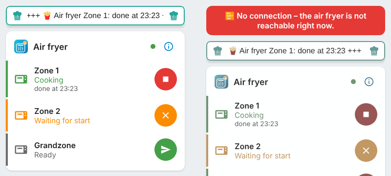

# 🍟 Airfryer Control for Home Assistant

🇩🇪 **Deutsch?** → [README auf Deutsch](README.md)

**Your Cosori air fryer on your dashboard.** Time remaining, “done at”, temperature and program – for each zone. Plus an event when the food is ready (“🍟 Fries are done!” on your phone or as an announcement), a stop button and actions for automations.

Built for models the official VeSync integration does **not** know – first of all the **Dual Blaze TwinFry 10 L** (CAF-TF101S / CAF-TF102S).

> 🧪 **Beta!** This integration is new. Cosori does not publish how its air fryers talk. Much of it is derived from the open ioBroker adapter and pyvesync and **has not been checked on every real air fryer yet**. If something looks odd, tell us (see below) and we'll fix it.

---

## ✨ What can it do?

| Feature | How |
|---|---|
| 🔥 **Status** | Off, Ready, Waiting for start, Preheating, Cooking, Paused, Drawer open, Done, Keeping warm, Offline. |
| ⏱️ **Time remaining & “done at”** | In minutes and as a time – overall and per zone. |
| 🧩 **Zones** | On the TwinFry, separate entities for zone 1, zone 2 and the **Grandzone** (the whole drawer without divider, the fryer calls it zone 3). |
| 🌡️ **Limits** | Temperature follows the program: Air Fry 120–205 °C, Roast 120–205 °C, Bake 80–205 °C, Grill 205–240 °C, Reheat 40–205 °C. If a value is not accepted, the integration tells you in plain words. |
| 🌡️ **Temperature & program** | Target temperature, measured temperature (if reported) and program (AirFry, Roast …). |
| 🔔 **“Done” event** | `airfryer_control_fertig` – for phone notifications, announcements or pausing the TV. |
| 📤 **Send (like the app)** | Set program, temperature and time per zone, then turn the switch **“Zone n send / stop”** on – like “Send” in the VeSync app. The fryer wakes up and waits for you to press Start on the device. (Cosori blocks remote start in the EU.) |
| ⏹️ **Stop cooking** | Button for the whole fryer – and the same switch per zone: off = stop that zone. |
| 🎛️ **Change temperature & time** | Number fields per zone. If the zone is already cooking, new values go straight to the fryer. |
| 🐢🐇 **Smart polling** | Idle: every 60 seconds (adjustable). Cooking: every 15 seconds. |
| 🛡️ **Privacy** | Your password is not stored, identifiers are redacted everywhere. Details below. |

---

## 📦 Installation

1. Open **HACS** → top right **⋮ → Custom repositories**.
2. Add `https://github.com/misterm2310/airfryer-control`, type **Integration**.
3. Search **Airfryer Control** → ⋮ → **Redownload** → enable **“Show beta versions”** → pick the newest → **Download**.
4. **Restart Home Assistant.**
5. **Settings → Devices & services → Add integration → Airfryer Control.**
6. Sign in with **the same account as in the VeSync app**, choose region **EU** or **US** – done. 🎉

<details><summary>Without HACS (manual)</summary>

Copy `custom_components/airfryer_control` to `/config/custom_components/airfryer_control` and restart Home Assistant.
</details>

---

## 👀 What you get

One device per air fryer. Entity IDs depend on the name in the app (here “Fritteuse”) and your Home Assistant language:

| Entity | Contents |
|---|---|
| `sensor.fritteuse_status` | Overall status (attribute `rohwert` = what the fryer actually reported) |
| `sensor.fritteuse_time_remaining` | Minutes until done (overall) |
| `sensor.fritteuse_done_at` | Time when everything is done |
| `sensor.fritteuse_zone_1_…` / `zone_2_…` / `zone_3_…` (Grandzone) | Status, time remaining, done at, program (only while cooking) |
| `select.fritteuse_zone_1_program` / `zone_2_…` / `zone_3_…` | Program used by “send”: Air Fry, Roast, Bake, Grill, Reheat, Dry. Changing it resets temperature and time to the fryer's suggested values. |
| `number.fritteuse_zone_1_set_temperature` / `…_set_cooking_time` | Temperature (35–240 °C) / minutes – sent along when you send. Time limits per program: Air Fry 1–60, Roast 1–240, Bake 1–240, Grill 1–30, Reheat 1–60, Dry 1–2880 (48 h); Dry 34–95 °C |
| `switch.fritteuse_zone_1_send_stop` / `zone_2_…` / `zone_3_…` | **On = send the values to the fryer** (it then waits for Start on the device). **Off = stop the zone.** Program, temperature and time are attributes. |
| `binary_sensor.fritteuse_cooking` | On while preheating, cooking or briefly paused |
| `button.fritteuse_stop_cooking` | Stop |
| *Diagnostic:* `binary_sensor.fritteuse_online`, `button.fritteuse_refresh_now`, `sensor.fritteuse_raw_data` | Connection, poll now, last cloud response (without identifiers) |

---

## 🃏 Ready-made cards (shipped with the integration)

Nothing extra to install – the integration ships two cards and registers them as dashboard resources automatically. In your dashboard choose **Add card** and search for **Airfryer Control** (reload the page once after an update).

| Card | What it does |
|---|---|
| `custom:airfryer-control-card` | One row per zone (Zone 1, Zone 2, Grandzone) with status, “done at …” and a round **send / cancel / stop** button. Tap a row for a dialog with program, temperature and time (per-program limits respected). The (i) shows credits, donation link and privacy. |
| `custom:airfryer-control-ticker` | The **ticker**: “Air fryer Zone 1: done at 19:42 +++ Zone 2: waiting for start”. Frame **red and pulsing** when a zone is done, otherwise teal. Hides itself when idle. Optionally includes extra timers (e.g. `sensor.einkaufsliste_kochtimer`). |

```yaml
type: custom:airfryer-control-card
title: Air fryer
```
```yaml
type: custom:airfryer-control-ticker
hide_when_idle: true
extra_entities:
  - sensor.einkaufsliste_kochtimer
```

The phone page and the sidebar (option “📌 Show in sidebar”, off by default) show the same cards.

Both cards have an editor, follow light/dark and run smoothly on a Fire TV. Zones are detected automatically. The cards only talk to your Home Assistant.

<p align="center"> </p>

**📋 Match and 🔗 Sync (in the card):** In a zone's dialog, **“Copy settings to Zone 2”** copies program, temperature and time to the other zone (Match). Above it, a hint tells you **when to start the other zone so both finish together** (Sync), e.g. “start Zone 2 in 4 min”. Honestly: there are no known Cosori cloud commands for this, so it is **my own solution**: the card only calculates and copies values. You still start on the device. Neither exists for the whole drawer.

**🟰 Send Match / 🔗 Send Sync (new, untested):** The zone dialog also has two buttons (and the services `match_senden` / `sync_senden`) that send Match or Sync to the fryer like the VeSync app – **prepare only** (zone shows “Waiting for start”), you start on the device. In Sync the shorter zone gets a wait time (state “Waiting for sync start” with remaining time). ⚠️ Honestly: I did not capture the exact app command; it is **rebuilt** from the fryer's observed state (`startMultiCook` with `syncType` 1/2) and **not yet verified on a real fryer**. Please try it first with a short time, next to the fryer.

> 🧪 The cards are still **beta** – if something is off, please report it.

## 📱 The phone app (no app store needed)

The integration ships **its own small page**: **`/airfryer_control/app/`** behind your Home Assistant address (e.g. `https://your-name.ui.nabu.casa/airfryer_control/app/`). It shows the ticker and the zone card full screen.

1. Open the address in your phone or tablet browser.
2. **Sign in** (with your Home Assistant account, just like the Home Assistant app). The page itself contains no data.
3. In the browser menu choose **“Add to home screen”** – done, the icon opens the air fryer directly.

The **🔅 Keep screen on** button keeps the display awake (handy for a kitchen tablet).

**Honestly:** without a connection nothing works on the fryer, because every command goes through Home Assistant and the Cosori cloud. So the app then shows **“No connection”** and **never** remembers a command to send it later (a delayed start would be dangerous). Only the program is cached so it starts fast. “Add to home screen” and fast start usually need an **https address** (e.g. Nabu Casa).

<p align="center"></p>

## 🤖 Automations

The event `airfryer_control_fertig` carries `geraet` (name), `modell`, `zone` (`1`, `2`, `3` or `alle` = whole fryer), `zustand` and `programm`.

```yaml
alias: Air fryer – food is ready
description: "Sends a phone notification as soon as the Cosori air fryer is completely done."
mode: single
triggers:
  - trigger: event
    event_type: airfryer_control_fertig
    event_data:
      zone: alle
conditions:
  # Maintenance switch: if it is on, stay quiet. Don't have one? Delete this condition.
  - condition: state
    entity_id: input_boolean.schalter_wartung
    state: "off"
actions:
  - action: notify.mobile_app_your_phone
    continue_on_error: true
    data:
      title: "🍟 Food is ready!"
      message: "{{ trigger.event.data.geraet }} is done. Enjoy!"
      data:
        ttl: 0
        priority: high
        sticky: true
        car_ui: true
        notification_icon: mdi:french-fries
        tag: fritteuse_fertig_01
```

| Action | What it does |
|---|---|
| `airfryer_control.senden_testen` | **For tinkerers, admins only:** sends `zone`, `temperatur`, `minuten`, `programm` to the fryer (without starting) and shows which variant it accepted. Without `variante` the safe variants are tried in turn until one works (never with start). |
| `airfryer_control.garen_beenden` | Stop. |
| `airfryer_control.programm_senden` | **For all users** (no admin rights needed, e.g. for the shopping list): sends `zone`, `temperatur`, `minuten`, `programm` to the fryer – **prepare only**, it never starts by itself. Temperature and time are limited to the program's range. Without `geraet` the only fryer is used. Response: `ok` (and `fehler` on failure). |
| `airfryer_control.match_senden` | **Match:** sends program, temperature and time of zone 1 to both zones. Prepares only – start on the device. ⚠️ Not yet confirmed on the real fryer. |
| `airfryer_control.sync_senden` | **Sync:** sends both zones with their times; the shorter zone waits (state “Waiting for sync start”) so both finish together. Prepares only – start on the device. ⚠️ Not yet confirmed on the real fryer. |
| `airfryer_control.befehl_senden` | **Tinkerers, admins only:** sends an app command and returns the response (without account data). |

---

## 🛡️ Privacy

Only Home Assistant talks to the VeSync server – exactly like your app. Nobody else.

- **Stored** (in Home Assistant, so also in your backups): your account **email**, **not** your password but only its **MD5 value** (VeSync needs it to log in; ⚠️ it can be used to log in, so treat backups like a key), a **random device ID**, your options.
- **Sent** only to **VeSync** (`smartapi.vesync.eu` / `smartapi.vesync.com`): login, device list, fryer status (every 15–60 s), your commands. **Nothing** goes to the developer or anyone else. No telemetry.
- **Redacted** everywhere (raw-data sensor, diagnostics, “send command” responses): token, account ID, device IDs (cid/uuid/MAC), email, image links. Password and token are never logged.
- **Removing** the integration deletes everything above from Home Assistant.

---

## 🙈 Honestly: what doesn't work (yet)

- **Unofficial.** If Cosori/VeSync change their server, it may break until updated.
- **Remote start** is blocked by Cosori in the EU – so there is no start button. “Send” only wakes the fryer; you start on the device.
- **“Send” is new.** The command (`startMultiCook` with `readyStart: true`) comes from a sister fryer (Cosori Turbo Tower Pro, pyvesync). On the TwinFry it prepares the program; the zone then shows “Waiting for start” and waits for the Start button on the device. Only **Air Fry** is confirmed so far; for Bake, Roast, Grill, Reheat and Dry the recipe number is a guess. ⚠️ With `readyStart: false` the TwinFry **starts right away** – the integration never sends that on its own (only via “Test sending” with `variante: multi_app_startet`).
- **Pause/resume:** command not known for sure yet – no button.
- **Stopping a single zone and changing temperature/time** are sent as the app is believed to do (`endCook` with zone, `setTimeOrTemp`) – **not yet tried on a real TwinFry**.
- **Field names** on the TwinFry are partly guessed. If a sensor shows nonsense, check `sensor.…_raw_data`.
- **Older 3.7/5.8 qt models** (CS…): display only, no start.

**Time remaining 60× too large/small?** Devices & services → Airfryer Control → **Configure** → “Time values of the air fryer” → seconds or minutes.

**When are new versions released?** Official releases on **Sundays**, beta versions on other days (HACS → ⋮ → Redownload → “Show beta versions”).

---

## 💙 Like it?

It is and stays **free**. If you like, you can send a small voluntary donation via PayPal: [paypal.me/MarcoStrickmann](https://paypal.me/MarcoStrickmann). Thank you! 🙏

[](https://paypal.me/MarcoStrickmann)

Ideas → [Discussions](https://github.com/misterm2310/airfryer-control/discussions) · Bugs → [Issues](https://github.com/misterm2310/airfryer-control/issues) (please attach **Download diagnostics**, identifiers are already redacted).

## 🙌 Credits & legal

Made by **Mister-M** – with help from **Claude**. Login flow and commands are based on the open [ioBroker adapter “vesync”](https://github.com/TA2k/ioBroker.vesync) (MIT) and [pyvesync](https://github.com/webdjoe/pyvesync) (MIT) – thanks! 🙏

Not an official product of Cosori, VeSync or Arovast. All trademarks belong to their owners. License: [MIT](LICENSE).
