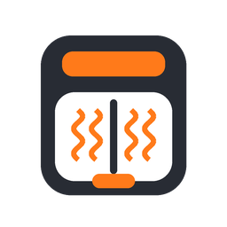
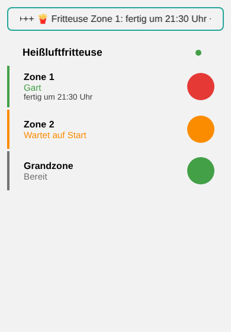
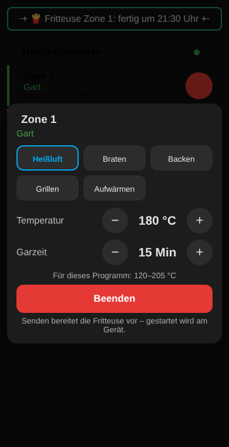

# 🍟 Airfryer Control für Home Assistant

🇬🇧 **English?** → [README in English](README.en.md)

**Deine Cosori-Heißluftfritteuse im Dashboard.** Restzeit, „Fertig um“, Temperatur und Programm – für jede Zone einzeln. Dazu ein Ereignis, wenn das Essen fertig ist („🍟 Pommes sind fertig!“ aufs Handy oder als Durchsage), ein Stopp-Knopf und Dienste für Automationen.

Gemacht für Modelle, die die offizielle VeSync-Integration **nicht** kennt – allen voran die **Dual Blaze TwinFry 10 L** (CAF-TF101S / CAF-TF102S).

> 🧪 **Beta!** Die Integration ist neu. Cosori legt die Daten der Fritteuse nirgends offen. Vieles ist aus dem offenen ioBroker-Adapter und pyvesync abgeleitet und **noch nicht an jeder echten Fritteuse geprüft**. Wenn etwas komisch angezeigt wird: Sag Bescheid (siehe unten), dann bessern wir nach.

---

## ✨ Was kann das Ding?

| Funktion | So klappt's |
|---|---|
| 🔥 **Zustand** | Aus, Bereit, Wartet auf Start, Heizt vor, Gart, Pausiert, Schublade offen, Fertig, Hält warm, Offline. |
| ⏱️ **Restzeit & „Fertig um“** | In Minuten und als Uhrzeit – gesamt und für jede Zone. |
| 🧩 **Zonen** | Bei der TwinFry eigene Entitäten für Zone 1, Zone 2 und die **Grandzone** (die ganze Schublade ohne Trennwand, die Fritteuse nennt sie Zone 3). |
| 🌡️ **Grenzen** | Die Temperatur passt sich dem Programm an: Heißluft 120–205 °C, Braten 120–205 °C, Backen 80–205 °C, Grillen 205–240 °C, Aufwärmen 40–205 °C. Passt ein Wert nicht, sagt die Integration es dir im Klartext. |
| 🌡️ **Temperatur & Programm** | Eingestellte Temperatur und Programm (AirFry, Roast …). Eine gemessene Temperatur gibt's nur, wenn die Fritteuse sie meldet (die TwinFry tut das nicht). |
| 🔔 **Ereignis „fertig“** | `airfryer_control_fertig` – für Handy-Nachricht, Alexa-/Google-Durchsage oder „Fernseher pausieren“. |
| 📤 **Senden (wie in der App)** | Pro Zone Programm, Temperatur und Garzeit einstellen und den Schalter **„Zone n senden / beenden“** auf An legen – wie „Senden“ in der VeSync-App. Die Fritteuse wacht auf und wartet, bis du am Gerät auf Start drückst. (Starten aus der Ferne sperrt Cosori in der EU.) |
| ⏹️ **Garen beenden** | Als Knopf für die ganze Fritteuse – und derselbe Schalter pro Zone: Aus = Zone beenden. |
| 🎛️ **Temperatur & Zeit ändern** | Eingabefelder pro Zone. Gart die Zone schon, gehen neue Werte direkt an die Fritteuse. |
| 🐢🐇 **Schlauer Takt** | Tut sie nichts: alle 60 Sekunden nachfragen (einstellbar). Arbeitet sie: alle 15 Sekunden. |
| 🛡️ **Datenschutz** | Dein Passwort wird nicht gespeichert, Kennungen werden überall geschwärzt. Details unten. |

---

## 📦 Installation

1. **HACS** öffnen → oben rechts **⋮ → Benutzerdefinierte Repositories**.
2. `https://github.com/misterm2310/airfryer-control` eintragen, Typ **Integration**, **Hinzufügen**.
3. Nach **Airfryer Control** suchen → ⋮ → **Neu herunterladen** → **„Beta-Versionen anzeigen“** einschalten → neueste Version wählen → **Herunterladen**.
4. **Home Assistant neu starten.**
5. **Einstellungen → Geräte & Dienste → Integration hinzufügen → Airfryer Control.**
6. Mit **demselben Konto wie in der VeSync-App** anmelden, Region **EU** (Deutschland/Europa) wählen – fertig. 🎉

<details><summary>Ohne HACS (von Hand)</summary>

Den Ordner `custom_components/airfryer_control` nach `/config/custom_components/airfryer_control` kopieren und Home Assistant neu starten.
</details>

> 💡 **Tipp:** Die Fritteuse muss zuerst in der VeSync-App eingerichtet sein. Die App kannst du weiter benutzen – beides geht gleichzeitig.

---

## 👀 Was du danach bekommst

Pro Fritteuse ein Gerät. Die Namen hängen davon ab, wie deine Fritteuse in der App heißt (hier: „Fritteuse“) und ob dein Home Assistant auf Deutsch läuft:

| Entität | Was steht drin |
|---|---|
| `sensor.fritteuse_zustand` | Gesamtzustand (Attribut `rohwert` = was die Fritteuse wirklich gemeldet hat) |
| `sensor.fritteuse_restzeit` | Minuten bis fertig (gesamt) |
| `sensor.fritteuse_fertig_um` | Uhrzeit, wann alles fertig ist |
| `sensor.fritteuse_zone_1_…` / `zone_2_…` / `zone_3_…` (Grandzone) | Zustand, Restzeit, fertig um, Programm (nur beim Garen) |
| `select.fritteuse_zone_1_programm` / `zone_2_…` / `zone_3_…` | Programm für „Senden“: Heißluft, Braten, Backen, Grillen, Aufwärmen, Dörren. Beim Wechsel setzt es Temperatur und Zeit auf die Vorschlagswerte der Fritteuse. |
| `number.fritteuse_zone_1_temperatur_einstellen` | Temperatur der Zone (35–240 °C) – wird beim Senden mitgeschickt |
| `number.fritteuse_zone_1_garzeit_einstellen` | Garzeit der Zone in Minuten – wird beim Senden mitgeschickt |
| `switch.fritteuse_zone_1_senden_beenden` / `zone_2_…` / `zone_3_…` | **An = Werte an die Fritteuse senden** (sie wartet dann auf Start am Gerät). **Aus = Zone beenden.** Das Programm, Temperatur und Zeit stehen als Attribute dabei. |
| `binary_sensor.fritteuse_gart_gerade` | An, solange vorgeheizt, gegart oder kurz pausiert wird |
| `button.fritteuse_garen_beenden` | Stopp für die ganze Fritteuse |
| *Diagnose:* `binary_sensor.fritteuse_online`, `button.fritteuse_jetzt_aktualisieren`, `sensor.fritteuse_rohdaten` | Verbindung, sofort nachfragen, letzte Antwort der Cloud (ohne Kennungen) und welche Abfragen die Fritteuse ablehnt |

Einfache Fritteusen mit nur einer Kammer bekommen statt der Zonen-Sensoren einfach `…_solltemperatur` und `…_programm` (und `…_temperatur`, wenn sie eine meldet). Nach einem Update räumt die Integration Entitäten, die es nicht mehr gibt, selbst weg.

> ⏱️ **Wie oft wird nachgefragt?** Tut die Fritteuse nichts: alle 60 Sekunden (einstellbar unter Konfigurieren). Gart sie: alle 15 Sekunden. Das sind bei 20 Minuten Pommes rund 80 kleine Anfragen – für den Server ein Klacks.

---

## 🃏 Die fertigen Karten (kommen mit der Integration)

Du musst **nichts extra installieren** – die Integration bringt zwei Karten selbst mit und trägt sie automatisch bei den Dashboard-Ressourcen ein. Im Dashboard auf **Karte hinzufügen** gehen und nach **Airfryer Control** suchen (nach einem Update einmal die Seite neu laden).

| Karte | Was sie macht |
|---|---|
| `custom:airfryer-control-card` | Eine Zeile pro Zone (Zone 1, Zone 2, Grandzone) mit Status, „fertig um …“ und rundem Knopf zum **Senden / Abbrechen / Beenden**. Antippen der Zeile öffnet ein Fenster mit Programm, Temperatur und Zeit (Grenzen je Programm werden beachtet). Das (i) oben zeigt Credits, Spenden-Link und Datenschutz. |
| `custom:airfryer-control-ticker` | Das **Laufband**: „Fritteuse Zone 1: fertig um 19:42 Uhr +++ Zone 2: wartet auf Start“. Rahmen **rot und blinkend**, wenn eine Zone fertig ist, sonst türkis. Blendet sich aus, wenn nichts läuft. Optional mit weiteren Kochtimern (z. B. `sensor.einkaufsliste_kochtimer`). |

```yaml
type: custom:airfryer-control-card
title: Heißluftfritteuse
```
```yaml
type: custom:airfryer-control-ticker
hide_when_idle: true
extra_entities:
  - sensor.einkaufsliste_kochtimer
speed: 60      # Pixel pro Sekunde (20–200)
```

Beide Karten haben einen Editor, passen sich Hell/Dunkel an und laufen auch flüssig auf dem Fire TV. Die Zonen werden automatisch gefunden. Die Karten reden nur mit deinem Home Assistant.

<p align="center"> </p>

> 🧪 Die Karten sind noch **Beta** – wenn etwas hakt, sag Bescheid (Fehler melden, siehe unten).

## 🖼️ Beispiel fürs Dashboard

```yaml
type: vertical-stack
cards:
  - type: tile
    entity: sensor.fritteuse_zustand
    name: Fritteuse
    icon: mdi:pot-steam
  - type: horizontal-stack
    cards:
      - type: tile
        entity: sensor.fritteuse_zone_1_restzeit
        name: Zone 1
      - type: tile
        entity: sensor.fritteuse_zone_2_restzeit
        name: Zone 2
  - type: tile
    entity: sensor.fritteuse_fertig_um
    name: Fertig um
  - type: entities
    entities:
      - entity: select.fritteuse_zone_1_programm
        name: Zone 1 Programm
      - entity: number.fritteuse_zone_1_temperatur_einstellen
        name: Zone 1 Temperatur
      - entity: number.fritteuse_zone_1_garzeit_einstellen
        name: Zone 1 Garzeit
      - entity: switch.fritteuse_zone_1_senden_beenden
        name: Zone 1 senden / beenden
      - entity: select.fritteuse_zone_2_programm
        name: Zone 2 Programm
      - entity: number.fritteuse_zone_2_temperatur_einstellen
        name: Zone 2 Temperatur
      - entity: number.fritteuse_zone_2_garzeit_einstellen
        name: Zone 2 Garzeit
      - entity: switch.fritteuse_zone_2_senden_beenden
        name: Zone 2 senden / beenden
  - type: tile
    entity: button.fritteuse_garen_beenden
    name: Alles stoppen
```

---

## 🤖 Für Automationen

### 🔔 Das Ereignis `airfryer_control_fertig`

Kommt, sobald etwas aufhört zu garen. Mit dabei:

| Feld | Beispiel | Bedeutung |
|---|---|---|
| `geraet` | `Fritteuse` | Name aus der App |
| `modell` | `CAF-TF101S-AEUR` | Modell |
| `zone` | `1`, `2`, `3` oder `alle` | Welche Zone fertig ist (`3` = Grandzone, `alle` = die ganze Fritteuse) |
| `zustand` | `fertig` | Zustand danach (`fertig`, `bereit`, `warmhalten` …) |
| `programm` | `AirFry` | Programm der Zone (falls bekannt) |

### 🍟 Beispiel: „Pommes sind fertig!“ aufs Handy

```yaml
alias: Fritteuse – Essen ist fertig
description: "Schickt eine Nachricht aufs Handy, sobald die Cosori-Fritteuse komplett fertig ist."
mode: single
triggers:
  - trigger: event
    event_type: airfryer_control_fertig
    event_data:
      zone: alle
conditions:
  # Wartungsschalter: Steht er auf „an“, bleibt es still.
  # Hast du keinen? Dann diese Bedingung einfach löschen.
  - condition: state
    entity_id: input_boolean.schalter_wartung
    state: "off"
actions:
  - action: notify.mobile_app_dein_handy
    continue_on_error: true
    data:
      title: "🍟 Essen ist fertig!"
      message: "Die {{ trigger.event.data.geraet }} ist fertig. Guten Appetit!"
      data:
        ttl: 0
        priority: high
        sticky: true
        car_ui: true
        notification_icon: mdi:french-fries
        tag: fritteuse_fertig_01
```

> 💡 Nur Zone 1? Dann bei `event_data` statt `zone: alle` einfach `zone: 1` schreiben.

### 🛠️ Dienste

| Dienst | Was er tut |
|---|---|
| `airfryer_control.senden_testen` | **Für Bastler, nur Admins:** schickt `zone`, `temperatur`, `minuten`, `programm` an die Fritteuse (ohne zu starten) und zeigt, welche Schreibweise sie angenommen hat. Ohne `variante` werden die sicheren Schreibweisen der Reihe nach probiert, bis eine klappt (nie mit Start). |
| `airfryer_control.garen_beenden` | Stopp. |
| `airfryer_control.befehl_senden` | **Für Bastler, nur Admins:** schickt einen App-Befehl (z. B. `getAirfryerMultiStatus`) und zeigt die Antwort – ohne Konto-Daten. Damit finden wir in der Beta heraus, was die Fritteuse alles versteht. |

---

## 🛡️ Datenschutz

Kurz gesagt: **Es redet nur Home Assistant mit dem VeSync-Server – genau wie deine App. Sonst niemand.**

**Was wird gespeichert?** (in Home Assistant, Datei `/config/.storage/core.config_entries`, also auch in deinen HA-Backups)
- deine **E-Mail** des VeSync-Kontos,
- **nicht** dein Passwort, sondern nur sein **MD5-Wert**. Den braucht VeSync zum Anmelden – auch die App schickt nie das Passwort selbst. ⚠️ Ehrlich: Mit diesem Wert kann man sich bei VeSync anmelden. Behandle deine Backups also wie einen Schlüssel.
- eine **zufällige Geräte-Kennung** für Home Assistant (wie ein „Handy“ in deinem Konto),
- deine Einstellungen (Takt, Zeiteinheit).

**Was geht ins Internet – und wohin?**
- Nur zu **VeSync** (`smartapi.vesync.eu` bzw. `smartapi.vesync.com` – der Server hinter der App).
- Anmeldung, Geräteliste, Zustand der Fritteuse (alle 15–60 Sekunden) und deine Befehle (Start/Stopp).
- **Nichts** geht an mich, an GitHub oder an andere Firmen. Keine Statistik, kein „nach Hause telefonieren“.

**Was wird geschwärzt?** Token, Konto-Nummer, Geräte-Nummern (cid/uuid/MAC), E-Mail und Bild-Links – im Sensor „Rohdaten“, in „Diagnose herunterladen“ und in den Antworten von „Befehl senden“. Ins Protokoll schreibt die Integration weder Passwort noch Token.

**Was passiert beim Entfernen?** Integration löschen = alles oben Gespeicherte ist aus Home Assistant weg. Dein VeSync-Konto und die App bleiben, wie sie sind. Wer ganz sichergehen will, ändert danach in der App sein Passwort – dann ist auch der alte MD5-Wert wertlos.

---

## 🙈 Ehrlich gesagt: Was (noch) nicht geht

- **Inoffiziell.** Cosori/VeSync bieten keine offene Schnittstelle. Ändern sie etwas am Server, kann die Integration ausfallen, bis sie angepasst ist.
- **Starten aus der Ferne:** In der EU erlaubt Cosori das **nicht** – darum gibt es keinen Start-Knopf. „Senden“ weckt die Fritteuse nur auf; gestartet wird am Gerät.
- **„Senden“ ist neu.** Der Befehl (`startMultiCook` mit `readyStart: true`) stammt von einer Schwester-Fritteuse (Cosori Turbo Tower Pro, pyvesync). An der TwinFry stellt er das Programm bereit; die Zone steht dann auf „Wartet auf Start“ und wartet auf den Start-Knopf am Gerät. Bestätigt ist bisher nur das Programm **Heißluft (AirFry)**; bei Backen, Braten, Grillen, Aufwärmen und Dörren ist die Rezept-Nummer geraten. ⚠️ Mit `readyStart: false` **startet** die TwinFry sofort – das schickt die Integration nie von selbst (nur im Dienst „Senden testen“ mit `variante: multi_app_startet`).
- **Pausieren/Fortsetzen:** Den Befehl dafür kennen wir noch nicht sicher – darum gibt es (noch) keinen Knopf.
- **Zone einzeln beenden und Temperatur/Zeit ändern** schicken die Befehle so, wie die App es nach heutigem Wissen tut (`endCook` mit Zone, `setTimeOrTemp`). An der echten TwinFry ist das noch **nicht ausprobiert**. Lehnt sie ab, bekommst du eine Meldung mit dem Grund.
- **Feldnamen:** Den Stillstand der TwinFry kennen wir aus einer echten Antwort, die Werte **während des Garens** noch nicht. Zeigt ein Sensor Quatsch, schau in `sensor.…_rohdaten` – dort steht, was die Fritteuse wirklich geschickt hat.
- **Ältere 3,7/5,8-Quart-Modelle** (CS…): nur Anzeige, kein Start. Für die gibt es auch die offizielle VeSync-Integration.

---

## ❓ Häufige Fragen

**Die Restzeit ist 60-mal zu groß oder zu klein.** Geräte & Dienste → Airfryer Control → **Konfigurieren** → „Zeitangaben der Fritteuse“ auf **Sekunden** oder **Minuten** stellen.

**Der Zustand steht auf „Offline“.** Die Fritteuse ist für die Cloud nicht erreichbar (Stecker, WLAN). Geht's in der App? Wenn ja: einmal `button.…_jetzt_aktualisieren` drücken.

**Muss ich die offizielle VeSync-Integration löschen?** Nein, beide können parallel laufen.

**Mein Modell wird nicht gefunden.** Dann ist es keine Fritteuse laut Cloud (Gerätetyp beginnt nicht mit CA/CS). Mach ein Issue auf, mit Modellnummer vom Typenschild.

**Wann kommen neue Versionen?** Offizielle Versionen immer **sonntags**. An den anderen Tagen gibt es nur **Test-Versionen (Beta)**. Die siehst du in HACS, wenn du ⋮ → „Neu herunterladen“ wählst und **„Beta-Versionen anzeigen“** einschaltest.

---

## 💙 Gefällt dir Airfryer Control?

Sie ist und bleibt **kostenlos**. Wenn du magst, kannst du mir ganz freiwillig eine kleine Spende per PayPal schicken: [paypal.me/MarcoStrickmann](https://paypal.me/MarcoStrickmann). Danke! 🙏

[](https://paypal.me/MarcoStrickmann)

## 💡 Ideen, Wünsche und Fehler

- **Idee oder Wunsch?** Schreib sie bei den [Diskussionen](https://github.com/misterm2310/airfryer-control/discussions).
- **Etwas funktioniert nicht?** Mach ein [Issue](https://github.com/misterm2310/airfryer-control/issues) auf. Am hilfreichsten: Modellnummer, Version und die Datei aus **Geräte & Dienste → Airfryer Control → ⋮ → Diagnose herunterladen** (Kennungen sind dort schon geschwärzt).

---

## 🧪 Für Entwickler

```bash
pip install -r requirements_test.txt
pytest -q
```

Die Tests laufen mit einer Attrappe der Cloud – es wird nichts ins Internet geschickt.

## 🙌 Credits & Rechtliches

Gemacht von **Mister-M** – mit Hilfe von **Claude**.
Der Anmelde-Ablauf und die Befehle stammen aus dem offenen [ioBroker-Adapter „vesync“](https://github.com/TA2k/ioBroker.vesync) (MIT) und [pyvesync](https://github.com/webdjoe/pyvesync) (MIT) – danke! 🙏

Kein offizielles Produkt von Cosori, VeSync oder Arovast. Alle Marken gehören ihren Inhabern. Lizenz: [MIT](LICENSE).
